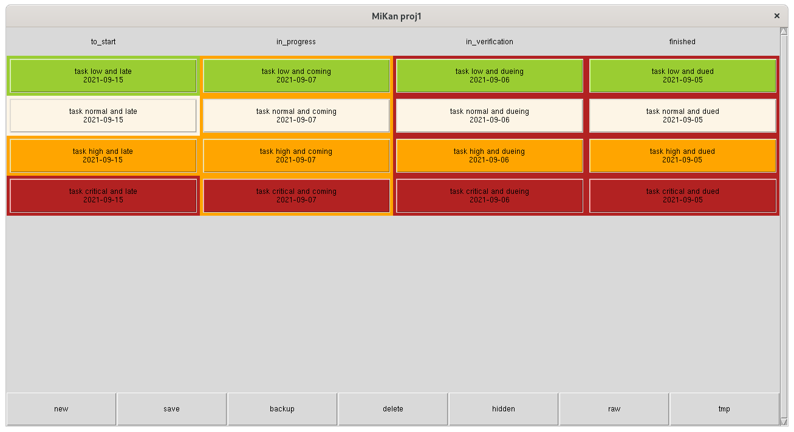
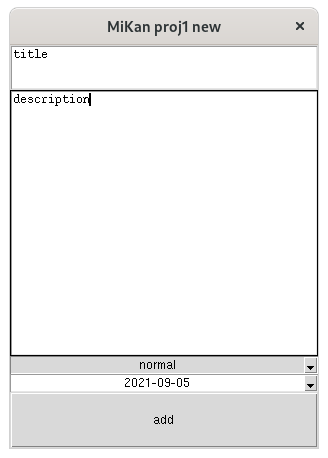

# MiKan

**A lightweight personal Kanban board for local task management.**

MiKan is built with Python and Tkinter. It keeps projects on your computer as editable JSON files, with no account, server, or network connection required.

<p align="center">
  
</p>

## Features

- **Custom workflows** - define each project's columns and keep work organized in stages
- **Task details** - add a title, description, priority level, and deadline
- **Visual deadlines** - task borders indicate urgency
- **Hidden tasks** - move inactive tasks out of the board and restore them later
- **Local project files** - save, back up, inspect, edit, and delete projects
- **Unsaved-change protection** - choose to save or discard changes when closing a board

### Priority and deadline colors

The task button shows the priority with its background color. The border shows deadline urgency, using working days and a Monday-Friday calendar.

| Priority | Background |
| --- | --- |
| Critical | Red |
| High | Orange |
| Normal | Cream |
| Low | Green |

| Deadline state | Border |
| --- | --- |
| Due in 1 working day or less / overdue | Red |
| Due in 2-3 working days | Orange |
| More than 3 working days away | Priority color |

## Screenshots

<table>
  <tr>
    <td align="center" valign="top">
      <strong>Main board</strong><br>
      
    </td>
    <td align="center" valign="top">
      <strong>Task editor</strong><br>
      
    </td>
  </tr>
</table>

## Getting started

### Requirements

- Python 3.10 or newer
- Tkinter

Tkinter is included with many standard Python distributions. If Tkinter is unavailable on Linux, install the distro package that provides `tkinter` (for example, `python3-tk` on Debian/Ubuntu).

### Run MiKan

Clone the repository and run the application from the project directory:

```bash
git clone https://github.com/t-lou/MiKan.git
cd MiKan
python3 main.py
```

On Windows, `py main.py` may be used instead of `python3 main.py`.

### Create a project

1. Launch MiKan.
2. Choose **create project**.
3. Enter a project name.
4. Add one workflow step per line.
5. Choose **create** to open the board.

The default workflow is:

```text
to_start
in_progress
in_verification
finished
```

`hidden` is reserved by MiKan and cannot be used as a workflow column.

## Working with tasks

Choose a task card to edit it. In the task dialog, enter:

- a title
- a description
- one of `critical`, `high`, `normal`, or `low`
- a deadline in `YYYY-MM-DD` format

Use the project controls in the dialog to move the task between workflow steps or to the hidden list. Titles and descriptions are required, and deadlines must use a valid, canonical `YYYY-MM-DD` date.

## Toolbar

| Control | Action |
| --- | --- |
| `new` | Create a task |
| `save` | Write the current project to disk |
| `backup` | Create a timestamped `.back` copy |
| `delete` | Delete the project file after confirmation |
| `hidden` | Open the hidden-task list |
| `raw` | Inspect and edit the project JSON saved on disk |
| `tmp` | Inspect and edit the current in-memory project JSON |

Closing a board with unsaved changes opens a prompt where you can **save** or **discard** them.

## Project files

Projects are stored in `.proj/` beside `main.py`. Each project uses the `.prj` extension.

```text
.proj/
  personal.prj
  work.prj
```

Example project data:

```json
{
  "name": "personal",
  "steps": [
    "to_start",
    "in_progress",
    "finished"
  ],
  "tasks": {
    "0": {
      "step": "to_start",
      "title": "Example task",
      "text": "Description",
      "level": "normal",
      "deadline": "2026-12-01"
    }
  }
}
```

## Development

Run MiKan directly with:

```bash
python3 main.py
```

The project uses `ruff`, `mypy`, and `pyright` configurations in `pyproject.toml` for linting and type checking.

## License

See [LICENSE.txt](LICENSE.txt).
